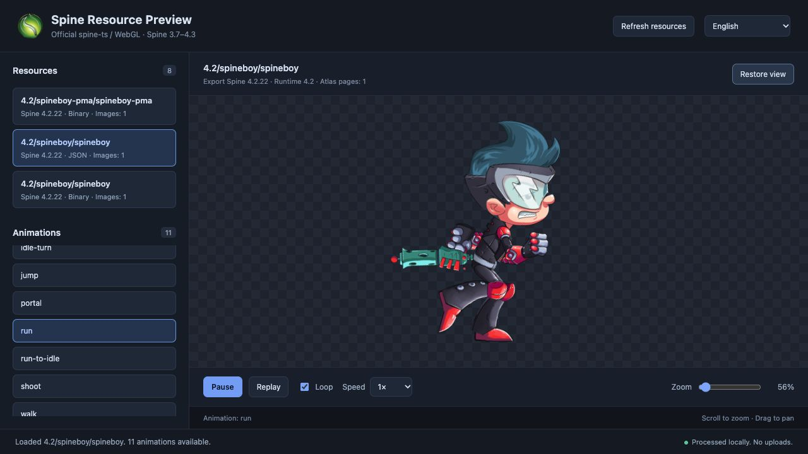

<p align="center">
  
</p>

# Spine Resource Preview

**Open a folder. Find your Spine assets. Play their animations.**

A local animation viewer for the **web and VS Code**, designed for artists, animators, game developers, and technical artists working with exported Spine resources. Inspect an export, browse every animation, and check how it renders without adding a preview scene to your game.

[简体中文](README.zh-CN.md) · [Getting started](#getting-started) · [Compatibility](#compatibility) · [License](#license-and-third-party-software)

## Preview



The web viewer after importing the official Spine 4.2 examples: resource browsing, the animation list, and Spineboy playing `run`. Example artwork © Esoteric Software; see the [original asset license](fixtures/official/4.2/LICENSE).

## Features

- **Folder-based discovery.** Import individual files or a folder in the web app. In VS Code, right-click a directory to find resources recursively.
- **Animation browsing.** Select a resource, choose an animation, pause, replay, loop, and adjust playback speed. Resources without animations display their setup pose.
- **Version-aware rendering.** Separate official runtimes for Spine 3.7, 3.8, 4.0, 4.1, 4.2, and 4.3, loaded as needed.
- **A useful preview canvas.** Transparent checkerboard, scroll-to-zoom, drag-to-pan, automatic fitting for oversized resources, and a one-click return to a centered 100% view.
- **Actionable diagnostics.** Missing atlas pages, ambiguous dependencies, unsupported versions, and runtime errors retain their file paths and original details. One invalid resource does not hide the other complete resources.
- **Local resource processing.** The application does not upload imported files. Runtimes are bundled with the application; rendering does not require a runtime CDN.
- **Ten interface languages.** English, Simplified Chinese, Traditional Chinese, Japanese, Korean, German, French, Spanish, Brazilian Portuguese, and Russian.

## Getting started

The web viewer and product website can be deployed together to GitHub Pages. The VS Code extension is currently available as a source build; Marketplace publishing is deferred.

### Web app

Prerequisites: **Node.js 22.12+** and **pnpm 10.20.0**.

From the repository root:

```sh
pnpm install --frozen-lockfile
pnpm dev
```

Open <http://127.0.0.1:5180/>. Choose resource files, choose a folder, or drop files/a folder onto the preview area. Select a resource in the sidebar, then click an animation to play it.

Import a complete export together:

```text
hero/
├── hero.json              # or hero.skel, if supported
├── hero.atlas
├── page-1.png
└── page-2.png             # include every page referenced by the atlas
```

Page filenames come from the atlas; they do not have to match the skeleton filename. Preserve subdirectories and relative paths when importing. Images may use PNG, WebP, JPG, or another format supported by the browser.

### VS Code extension

Requires **VS Code 1.90+**. Build the installation package from the repository root:

```sh
pnpm package:vscode
```

In VS Code, run **Extensions: Install from VSIX…** and select `apps/vscode/dist/spine-resource-preview.vsix`.

| Explorer selection              | What happens                                                                                                                                |
| ------------------------------- | ------------------------------------------------------------------------------------------------------------------------------------------- |
| Directory                       | Scans the selected directory and all subdirectories, then lists complete resources.                                                         |
| Skeleton `.json` / `.skel` file | Scans skeletons in its containing directory, without recursively discovering skeletons in subdirectories; selects the clicked resource.     |
| Atlas or image file             | Scans the containing directory and selects the associated resource when the association is unique. Ambiguous associations show diagnostics. |

Right-click the selection and choose **Preview Spine Resources**. Dependencies referenced inside subdirectories can still be loaded when a file is selected. The panel also provides native file/folder selection and resource refresh.

The extension runs from its bundled files and needs no development server. Its current publisher, `local-spine-preview`, is a development identifier, not a Marketplace publisher.

## Compatibility

| Spine export version | JSON | Binary `.skel` | Runtime source                            |
| -------------------- | :--: | :------------: | ----------------------------------------- |
| 3.7                  | Yes  |       No       | Official spine-ts, pinned upstream commit |
| 3.8                  | Yes  |      Yes¹      | Official spine-ts, pinned upstream commit |
| 4.0                  | Yes  |      Yes       | Official spine-webgl 4.0.31               |
| 4.1                  | Yes  |      Yes       | Official spine-webgl 4.1.55               |
| 4.2                  | Yes  |      Yes       | Official spine-webgl 4.2.120              |
| 4.3                  | Yes  |      Yes²      | Official spine-webgl 4.3.13               |

¹ Some historical 3.8 binary exports, including 3.8.75, need a compatible re-export and are explicitly rejected.

² The checked-in 4.3 examples were exported with `4.3.75-beta`. Prerelease information is preserved. These examples do not establish compatibility with every historical beta export.

Runtime selection follows the export's **major/minor version**. Patch-level compatibility is subject to the corresponding official runtime. Export and runtime versions are visible in the viewer; unsupported or malformed data produces a diagnostic.

Use a current browser with WebGL enabled. The build targets Chromium 108+ and Safari 16+; these targets are not a complete cross-browser certification matrix.

## Language and privacy

The viewer opens in **English** by default. Use the language selector in the header; your explicit choice is saved locally when storage is available. The VS Code command, progress notifications, and native dialogs follow the editor's display language independently.

Resource names, animation names, paths, and original runtime error details remain unchanged. Known diagnostic descriptions are localized. Imported files are read through browser APIs or the VS Code file API and are not sent to a server. On remote VS Code workspaces, reads follow VS Code's remote file API; those environments have not yet been fully verified.

## Troubleshooting and limitations

- **A resource is missing from the list:** include its skeleton, matching atlas, and every atlas page image. Check diagnostics and preserve relative paths; a missing image is not substituted with another directory's same-named file.
- **Clipped animation after switching actions:** fitting uses the current pose bounds. Large changes in an animation's range may require clicking **Fit to canvas** again.
- **Unexpected transparency:** explicit atlas PMA metadata takes priority. Old files without metadata or recognizable PMA names cannot be classified reliably from PNG pixels alone.
- **WebGL context lost:** reselect or reload the resource.
- **VS Code drag-and-drop does not work:** some platforms do not expose file URIs to Webviews. Use the Explorer context menu or the native selection buttons.

Remote SSH, Dev Containers, VS Code Web, and platform-specific Explorer drops have not completed environment validation. Real VS Code Webview GPU playback also needs environment acceptance testing. Automated parsing, version routing, and extension API tests do not replace those checks.

## Build and deploy

```sh
pnpm build:web
pnpm --filter @spine-preview/web preview
pnpm package:vscode
```

The web build is written to `apps/web/dist`; preview runs at <http://127.0.0.1:4180/>. Deploy the **entire** directory, including its `licenses/` folder, with a static HTTP server. Asset references are relative (`./assets/...`), source maps are disabled, and all runtimes are bundled locally.

The VSIX is written to `apps/vscode/dist/spine-resource-preview.vsix`. Before a Marketplace release, configure the actual publisher and repository metadata and complete the environment checks listed above.

### Product website and GitHub Pages

Build and preview the complete website locally:

```sh
pnpm build:site
pnpm check:site
pnpm preview:site
```

Open <http://127.0.0.1:4181/>. The single deployment directory is `dist/site`: the product website lives at the root, and the compiled `apps/web` viewer lives at `app/`. All assets and runtime licenses are included. The website uses the checked-in English screenshot and provides English/Simplified Chinese content; the viewer keeps its independent ten-language selector.

For GitHub Pages:

1. Push the source repository, including `.github/workflows/pages.yml` and `pnpm-lock.yaml`, to GitHub.
2. In **Settings → Pages → Build and deployment**, select **GitHub Actions** as the source.
3. Push to `main` or run **Deploy website to GitHub Pages** manually from the Actions tab.
4. Wait for the build and deployment jobs, then open the URL shown by the deployment.

For a project repository, the website will be at `https://<account>.github.io/<repository>/`, with the viewer at `https://<account>.github.io/<repository>/app/`. An `<account>.github.io` repository serves the same structure directly at the account domain. Relative paths support both layouts without hard-coding the repository name. One Pages deployment publishes both targets; a separate web upload is unnecessary.

The workflow reads the public repository URL from GitHub's own `GITHUB_REPOSITORY` environment variable. For a local build with source links, set `VITE_REPOSITORY_URL` to your HTTPS repository URL. Without it, the website links to its bundled documentation. Deployment is triggered only after the workflow is pushed; no GitHub upload is performed by local build commands.

For website development, run `pnpm dev:site` on port 5181 and `pnpm dev` for the viewer on port 5180 in another terminal. Website source lives in `apps/site`; its copy is separated into `src/content.ts`.

## Development and contributions

Built with **TypeScript 7, React, Vite, and pnpm workspace**.

| Directory           | Responsibility                                                                    |
| ------------------- | --------------------------------------------------------------------------------- |
| `apps/site`         | Product website with English/Chinese content and links to the hosted viewer       |
| `apps/web`          | Browser entry point and local file import                                         |
| `apps/vscode`       | VS Code extension host, discovery, and Webview bridge                             |
| `packages/core`     | Version identification, atlas parsing, dependency discovery, and shared contracts |
| `packages/runtimes` | Version-specific runtime adapters and preview lifecycle                           |
| `packages/viewer`   | Shared React interface, language packs, and branding                              |
| `vendor`            | Pinned official 3.7/3.8 runtime modules and provenance                            |
| `fixtures`          | Official examples, historical regression samples, and negative cases              |

Run checks before submitting changes:

```sh
pnpm typecheck
pnpm test
pnpm format:check
pnpm build
pnpm package:vscode
pnpm check:output
```

VS Code extension debugging is available through the checked-in `.vscode/launch.json`; its development host uses an isolated profile. TypeScript type checking uses single-threaded resolution to avoid an observed alias-resolution issue involving multiple versions of the same runtime package.

Bug reports are most useful with the full Spine export version, JSON/binary format, browser or VS Code version, reproduction steps, and the diagnostic text. Share a minimal sample only when you have permission to distribute it; proprietary game resources are not required for a report.

Contributions to compatibility, diagnostics, localization, and resource handling are welcome. Keep version routing explicit, preserve upstream runtime bytes and licenses, and verify resource cleanup on failures and cancellations. New language packs must cover all English keys and retain their interpolation fields; the tests check both.

### Test resources

`fixtures/official` contains 24 official sample groups and 44 skeleton entries across the six supported versions, including Spineboy, Tank, Raptor, and PMA examples. It can be imported as one folder. `fixtures/regression` retains distinct ESS and historical 3.8.99 samples; `fixtures/negative` contains the deliberately unsupported 3.7 binary.

Each regression group is independently importable. Importing all of `fixtures` discovers 47 complete skeletons and intentionally reports eight 4.3 beta notices and one unsupported 3.7 binary diagnostic. `fixtures:check` also verifies this whole-folder import and regression provenance.

```sh
pnpm fixtures:fetch       # download from pinned official commits
pnpm fixtures:check       # verify existing files offline
```

See [fixture provenance and scope](fixtures/official/README.md) for original URLs, export versions, hashes, and licenses. Test resources are excluded from web and VSIX distributions. Current official examples are single-page atlases; automated multi-page dependency tests do not establish real multi-page rendering coverage.

## License and third-party software

**Project-authored code is licensed under [MIT](LICENSE).** Third-party code and example assets retain their own licenses and are outside that grant.

- **Spine runtimes and official example assets:** © Esoteric Software LLC, under the applicable **Spine Runtimes License Agreement** and upstream asset terms. Integration, use, and redistribution are subject to those terms, including conditions concerning Spine Editor licenses. Review the bundled original licenses and the [Spine Editor License Agreement](https://esotericsoftware.com/spine-editor-license). MIT does not replace them.
- **React, React DOM, and Scheduler:** MIT, with their original copyright notices.

The full attribution inventory is maintained in [THIRD_PARTY_NOTICES.md](THIRD_PARTY_NOTICES.md). Web and VSIX builds include the project license, third-party notices, and original runtime/library licenses. Preserve them when redistributing a build.

This project is independently maintained and is not affiliated with or endorsed by Esoteric Software. Spine is a product of Esoteric Software.
