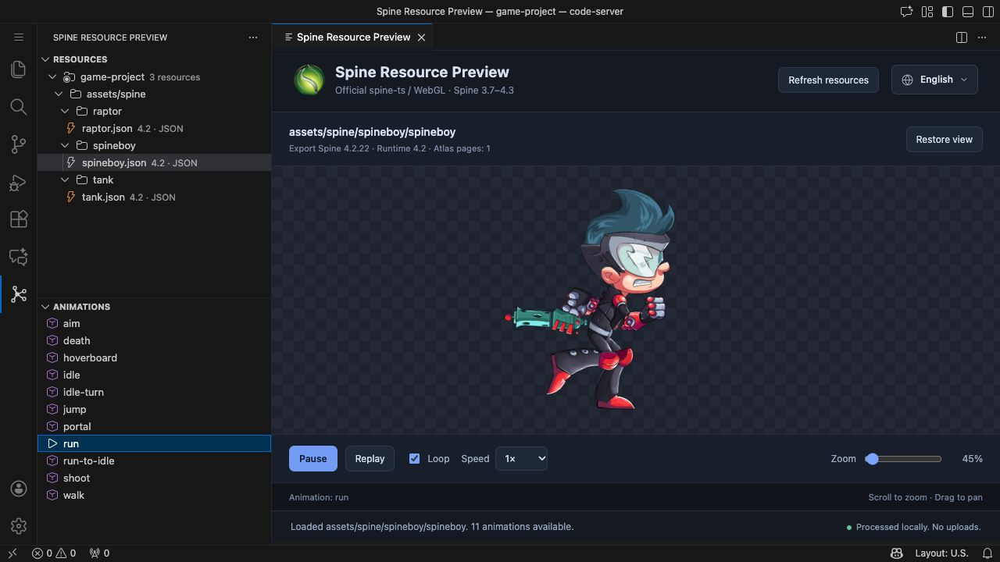

<p align="center">
  
</p>

# Spine Resource Preview

**打开资源目录，找到 Spine 资源，直接播放动画。**

一个面向 **Web 和 VS Code** 的本地 Spine 动画预览工具，为美术、动画师、游戏开发者和技术美术提供统一的资源检查界面。无需在游戏里临时搭建预览场景，即可查看导出资源、切换动作并检查渲染结果。

[English](README.md) · [快速开始](#快速开始) · [兼容范围](#兼容范围) · [开源许可](#开源许可与第三方软件)

## 运行截图


导入官方 Spine 4.2 示例后的 Web 界面，展示资源列表、动画选择和 Spineboy 的 `run` 动画播放。示例美术版权归 Esoteric Software，详见[素材原始许可](fixtures/official/4.2/LICENSE)。

## 主要功能

- **按目录发现资源。** Web 支持文件选择、文件夹导入和拖放；VS Code 打开 Spine 侧栏即可发现工作区资源，也可右键目录限定范围。
- **VS Code 原生实时导航。** 资源与动画列表位于原生侧栏，支持多工作区目录；导出文件或依赖变化时自动更新，无关文件变化不会重启当前动画。
- **浏览和播放动画。** 选择资源、切换动画、暂停、重播、循环和调整播放速度；没有动画时显示初始姿态。
- **按版本渲染。** 为 Spine 3.7、3.8、4.0、4.1、4.2、4.3 分别使用独立的官方运行时，按需加载。
- **便于检查的画布。** 固定透明棋盘背景、滚轮缩放、拖动平移；较大的资源首次自动适应画布，可一键恢复到 100% 并居中。
- **可定位的诊断。** 缺少图片、依赖歧义、未知版本及 runtime 错误保留文件路径与原始细节；单个资源无效不影响其它完整资源出现。
- **本地处理。** 应用不上传导入文件，运行时随应用打包，渲染无需 runtime CDN。
- **十种界面语言。** 英语、简体中文、繁体中文、日语、韩语、德语、法语、西班牙语、巴西葡萄牙语和俄语。

## 快速开始

Web 工具与产品宣传页可以一起部署到 GitHub Pages。VS Code 插件已在 [Visual Studio Marketplace](https://marketplace.visualstudio.com/items?itemName=cceevv.spine-resource-preview) 上架，也可从源码构建安装。

### Web 版本

环境要求：**Node.js 22.12+**、**pnpm 10.20.0**。在仓库根目录运行：

```sh
pnpm install --frozen-lockfile
pnpm dev
```

打开 <http://127.0.0.1:5180/>，选择资源文件、选择文件夹，或将文件／文件夹拖到预览区。之后在左侧选择资源，点击动画名称开始播放。

请一次导入完整资源：

```text
hero/
├── hero.json              # 支持的版本也可使用 hero.skel
├── hero.atlas
├── page-1.png
└── page-2.png             # 包含 atlas 引用的全部页图片
```

图片名称由 atlas 决定，不要求与骨骼同名。导入时保留子目录与相对路径。支持 PNG、WebP、JPG 等浏览器能够解码的图片格式。

### VS Code 插件



原生侧栏负责浏览资源和动画，编辑器画布保留播放、缩放和平移控件。示例美术 © Esoteric Software，见[素材原始许可](fixtures/official/4.2/LICENSE)。

可从 [Marketplace 安装 Spine Resource Preview](https://marketplace.visualstudio.com/items?itemName=cceevv.spine-resource-preview)，或使用下面的本地 VSIX 构建方式。

要求 **VS Code 1.90+**。在仓库根目录构建安装包：

```sh
pnpm package:vscode
```

在 VS Code 执行 **Extensions: Install from VSIX…**（从 VSIX 安装），选择 `apps/vscode/dist/spine-resource-preview.vsix`。

| 资源管理器中选择的对象      | 预览行为                                                           |
| --------------------------- | ------------------------------------------------------------------ |
| 目录                        | 递归扫描目录及全部子目录，列出完整资源。                           |
| 骨骼 `.json` / `.skel` 文件 | 扫描文件所在目录的骨骼，不递归发现子目录骨骼；直接选中点击的资源。 |
| atlas 或图片文件            | 扫描所在目录，关联唯一时选中对应资源；多个关联时展示诊断。         |

点击活动栏中的 **Spine** 图标，首次打开会递归扫描所有工作区目录，多目录分别分组。在原生“资源”视图中点击资源打开编辑区预览，再从“动画”视图切换动作。扫描本身不会打开预览页；二进制资源的动画名在加载后显示。

右键选择 **Preview Spine Resources**；简体中文 VS Code 显示 **预览 Spine 资源**。右键操作按上表临时限定范围，将鼠标移到“资源”标题栏，点击根文件夹图标的“返回工作区”，即可恢复全部工作区目录；也可以在命令面板执行 **Spine: 返回工作区**。该按钮仅在临时查看文件或目录时显示。“刷新资源”只刷新当前范围，不会切回整个项目。选择文件时，其引用的子目录依赖仍然可以加载。预览页也提供原生文件／文件夹选择按钮。

当前范围内的资源、atlas 和页图片新增、修改、移动或删除时会自动更新；补齐缺失依赖后，资源会出现在列表中。无关资源变化不重启当前动画；当前资源变化时重新加载，保留仍存在的动作；删除当前资源会清空画布。需要手动重扫时使用侧栏工具栏的“刷新资源”。`.git`、`node_modules`、`dist`、`build` 等常见生成目录不参与发现。

插件从打包文件直接运行，无需开发服务器。插件标识为 `cceevv.spine-resource-preview`。

## 兼容范围

| Spine 导出版本 | JSON | 二进制 `.skel` | 运行时来源                     |
| -------------- | :--: | :------------: | ------------------------------ |
| 3.7            | 支持 |     不支持     | 官方 spine-ts，固定上游 commit |
| 3.8            | 支持 |     支持¹      | 官方 spine-ts，固定上游 commit |
| 4.0            | 支持 |      支持      | 官方 spine-webgl 4.0.31        |
| 4.1            | 支持 |      支持      | 官方 spine-webgl 4.1.55        |
| 4.2            | 支持 |      支持      | 官方 spine-webgl 4.2.120       |
| 4.3            | 支持 |     支持²      | 官方 spine-webgl 4.3.13        |

¹ 部分历史 3.8 二进制（包括 3.8.75）需要重新导出兼容格式，工具会明确拒绝。

² 仓库中的 4.3 官方样本使用 `4.3.75-beta` 导出，会保留 beta 信息。这些样本不能证明所有历史 beta 都兼容。

运行时按导出的**主、次版本**选择，补丁版本兼容性由对应官方 runtime 决定。界面显示实际导出版本与 runtime 版本；未知或损坏数据会给出诊断。

浏览器需支持并启用 WebGL。构建目标为 Chromium 108+、Safari 16+，这不等于已经完成全部浏览器兼容认证。

## 语言与隐私

预览界面首次默认 **English**。右上角可切换语言，存储可用时会在本机保存明确选择。VS Code 的原生侧栏、右键命令、进度和选择框独立跟随编辑器显示语言。

资源名、动画名、路径和原始 runtime 错误保持原样；已知诊断说明会本地化。文件通过浏览器 API 或 VS Code 文件 API 读取，不发送给服务器。远程 VS Code 工作区会按编辑器的远程文件 API 读取，该环境尚未完成完整验证。

## 常见问题与限制

- **资源没有出现在列表：** 确认骨骼、对应 atlas 和所有页图片齐全，查看诊断并保留相对路径；缺失图片不会使用其它目录中的同名图片代替。
- **切换动作后被裁切：** 适应画布使用当前姿态边界；动画范围变化较大时可再次点击“适应画布”。
- **透明边缘异常：** 优先使用 atlas 中明确的 PMA 标记。旧资源没有标记且命名不可识别时，无法仅凭 PNG 像素可靠推断预乘状态。
- **WebGL 上下文丢失：** 重新选择或加载资源。
- **VS Code 拖放无效：** 部分平台不会向 Webview 暴露文件 URI，请使用资源管理器右键菜单或原生选择按钮。

Remote SSH、Dev Containers、VS Code Web 及各平台 Explorer 拖放尚未完成环境验收，真实 VS Code Webview GPU 播放也需要实际环境验证。自动化解析、版本路由与插件 API 测试不能替代这些检查。

## 构建与部署

```sh
pnpm build:web
pnpm --filter @spine-preview/web preview
pnpm package:vscode
```

Web 产物位于 `apps/web/dist`，本地预览地址为 <http://127.0.0.1:4180/>。通过静态 HTTP 服务部署**整个目录**，包括 `licenses/`。资源引用使用相对路径 `./assets/...`，不生成 source map，运行时全部随构建打包。

VSIX 位于 `apps/vscode/dist/spine-resource-preview.vsix`。发布后续更新前需完成上述环境验收。

### 产品宣传页与 GitHub Pages

本地构建并预览完整站点：

```sh
pnpm build:site
pnpm check:site
pnpm preview:site
```

打开 <http://127.0.0.1:4181/>。唯一部署目录为 `dist/site`：根目录是产品宣传页，`app/` 是 `apps/web` 编译后的预览工具。资源与 runtime 许可原文均随站点附带。宣传页使用仓库中的英文截图，支持与预览工具相同的十种语言，两者独立保存语言偏好。

部署到 GitHub Pages：

1. 将源码仓库提交到 GitHub，包括 `.github/workflows/pages.yml` 与 `pnpm-lock.yaml`。
2. 在 **Settings → Pages → Build and deployment** 将 Source 设为 **GitHub Actions**。
3. 推送到 `main`，或在 Actions 手动运行 **Deploy website to GitHub Pages**。
4. 等待构建与部署任务完成，打开部署结果中的网址。

普通项目仓库的首页地址为 `https://<账号>.github.io/<仓库>/`，工具地址为 `https://<账号>.github.io/<仓库>/app/`。名为 `<账号>.github.io` 的仓库则直接使用账号域名，工具位于 `/app/`。相对路径同时适配两种结构，无需写死仓库名。一次 Pages 部署包含宣传页和工具，不用再单独上传 Web 产物。

工作流会从 GitHub 提供的 `GITHUB_REPOSITORY` 环境变量自动生成公开仓库链接。本地构建可设置 HTTPS 格式的 `VITE_REPOSITORY_URL`；未配置时，宣传页链接到随站点附带的使用文档。只有工作流提交到远程后才会触发部署，本地构建命令不会上传 GitHub。

开发宣传页使用 `pnpm dev:site`（5181 端口），在另一个终端运行 `pnpm dev` 提供工具入口（5180 端口）。页面源码位于 `apps/site`，宣传文案按语言拆分在 `src/locales/`，语言代码和显示名称与 viewer 共用 `@spine-preview/viewer/languages` 登记表。VS Code 专区从插件清单读取 publisher、版本和最低编辑器版本；构建时检查公开商店索引，上架可检索后显示商店链接与 VS Code 安装入口。查询不可用时仍保留 VSIX 说明。离线构建可用 `VITE_EXTENSION_PUBLISHED=true` / `false` 明确选择展示状态，访客浏览器不会请求商店 API。

## 开发与贡献

技术栈：**TypeScript 7、React、Vite、pnpm workspace**。

| 目录                | 职责                                        |
| ------------------- | ------------------------------------------- |
| `apps/site`         | 产品宣传页、十种语言文案与在线预览工具入口  |
| `apps/web`          | 浏览器入口与本地文件导入                    |
| `apps/vscode`       | 扩展宿主、目录发现与 Webview 桥接           |
| `packages/core`     | 版本识别、atlas 解析、依赖发现与公共契约    |
| `packages/runtimes` | 各版本 runtime 适配及预览生命周期           |
| `packages/viewer`   | 共享 React 界面、语言包与品牌资源           |
| `vendor`            | 固定版本的官方 3.7 / 3.8 runtime 与来源记录 |
| `fixtures`          | 官方样本、历史回归样本与负例                |

提交改动前运行：

```sh
pnpm typecheck
pnpm test
pnpm format:check
pnpm build
pnpm package:vscode
pnpm check:output
```

可用仓库中的 `.vscode/launch.json` 启动隔离配置的扩展开发宿主。TypeScript 检查使用单线程解析，规避已观察到的多版本同名 runtime 包别名解析问题。

报告问题时请提供完整导出版本、JSON／binary 格式、浏览器或 VS Code 版本、复现步骤和诊断文本。仅在有权分发时分享最小样本；提交问题不要求公开专有游戏资源。

欢迎贡献兼容性修复、诊断改进、本地化和资源处理功能。保持明确的版本路由，保留官方代码与许可原文，验证失败和取消时的资源清理。新增语言包需覆盖英文包所有键，并保持插值字段一致，测试会校验这两项。

### 测试资源

`fixtures/official` 包含六个版本的 24 组官方样本、44 个骨骼入口，含 Spineboy、Tank、Raptor 和 PMA 示例，可一次导入整个目录。`fixtures/regression` 仅保留独有的 ESS 与历史 3.8.99 样本；`fixtures/negative` 包含明确不支持的 3.7 二进制。

每个回归样本组都可以独立导入。整体导入 `fixtures` 应发现 47 个完整骨骼，并保留 8 条 4.3 beta 说明和 1 条刻意设置的 3.7 二进制拒绝诊断。`fixtures:check` 也会检查整目录导入及回归资源来源。

```sh
pnpm fixtures:fetch       # 从固定的官方 commit 下载
pnpm fixtures:check       # 离线检查已有文件
```

来源、版本、哈希、许可和验证范围见[测试资源说明](fixtures/official/README.md)。这些素材不随 Web 或 VSIX 发布。当前官方样本均为单页 atlas；自动化多页依赖测试不代表真实多页渲染已完成验证。

## 开源许可与第三方软件

**项目自有代码采用 [MIT 许可证](LICENSE)。** 第三方代码和样本仍遵循各自原始许可，不包含在该授权范围内。

- **Spine runtimes 与官方示例资源：** 版权归 Esoteric Software LLC，适用各版本的 **Spine Runtimes License Agreement** 及上游素材条款。集成、使用和再分发受这些条款约束，其中包含有关 Spine Editor 授权的条件。请阅读随包附带的许可原文及 [Spine Editor License Agreement](https://esotericsoftware.com/spine-editor-license)，MIT 不会替代这些条款。
- **React、React DOM 与 Scheduler：** MIT，保留原始版权声明。

完整第三方清单维护在 [THIRD_PARTY_NOTICES.md](THIRD_PARTY_NOTICES.md)。Web 和 VSIX 产物附带项目许可、第三方说明及 runtime／库许可原文；再分发时请一并保留。

本项目独立维护，与 Esoteric Software 没有隶属或背书关系。Spine 是 Esoteric Software 的产品。
